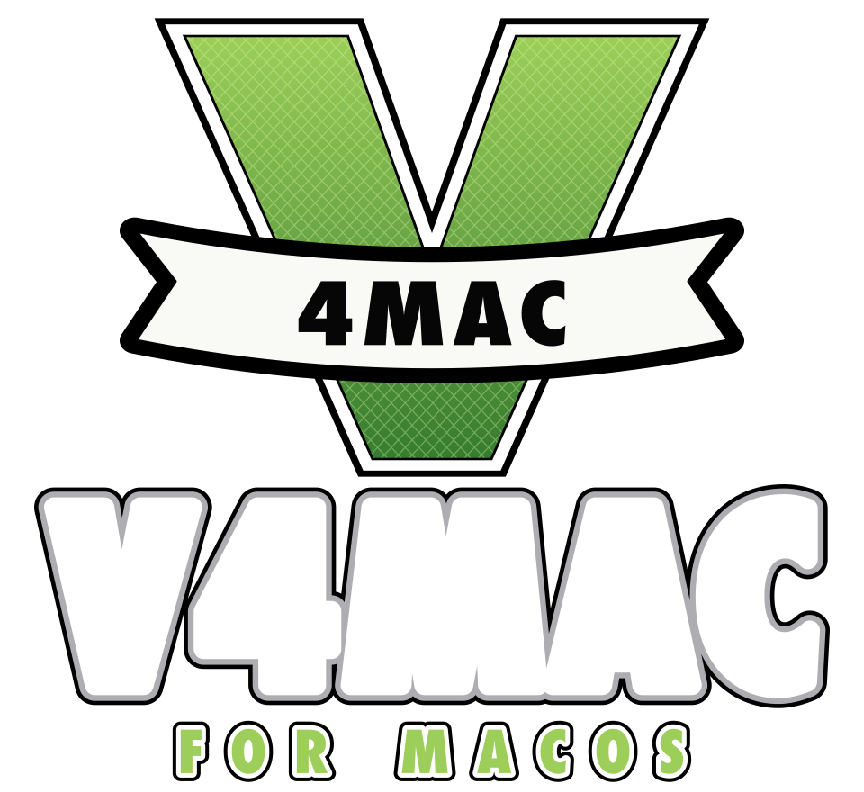

<p align="center">
  
</p>

<h1 align="center">V4Mac</h1>

<p align="center">
A native macOS build of the GTA V web port, with a custom launcher, an in-game mod menu with a car spawner, and external mod folder support.<br>
<sub>A fork of <a href="https://github.com/c22dev/muguet">Muguet</a> by c22dev, extended by OffSpace.</sub>
</p>

---

## What is this?

V4Mac is a fork of [**Muguet**](https://github.com/c22dev/muguet) by [Constantin Clerc (c22dev)](https://github.com/c22dev). Muguet runs the WebAssembly build of the game (`game.wasm`) as a regular native app. The browser layer is replaced with [wasmtime](https://wasmtime.dev) for the code and [wgpu](https://wgpu.rs) on Metal for graphics. On macOS the game code is compiled to native arm64 on first launch and then cached.

All of that work is Muguet's. V4Mac builds on top of it and adds the features below.

> **You need your own copy of the game files.** Nothing from the game is included or downloaded by this repository. See [Game files](#game-files).

## Features

### Added in V4Mac

- **In-game mod menu**, native and built into the port. Press <kbd>`</kbd> (backtick) to open it, <kbd>↑</kbd>/<kbd>↓</kbd> to move, <kbd>Enter</kbd> to select and <kbd>Backspace</kbd> to go back.
  - **Player**: god mode, heal, full armor, clear or raise your wanted level, never wanted.
  - **Spawn vehicle**: a car spawner with 10 categories (Super, Sports, Muscle, Sedans & SUVs, Bikes, Helicopters, Planes, Boats, Emergency & Military, Misc). The model streams in, then the vehicle spawns.
  - **Current vehicle**: repair, flip upright, boost forward, indestructible toggle and delete for the vehicle you are in.
  - **Teleport**: 10 preset locations.
  - **World**: time of day, weather (clear, rain, thunder and more) and slow motion.
  - The menu is disabled in multiplayer, and it can be switched off in the launcher.
- **External mod support**: drop files into `~/Library/Application Support/V4Mac/mods/<ModName>/…` and they are overlaid on the game's file tree at startup. See [Mods](#mods).
- **Redesigned launcher** with a V4Mac logo, an artwork background, a larger window, a Mod Menu toggle and the full settings panel visible at once.
- **Original branding**: the logo, icon and launcher artwork are drawn from scratch for V4Mac. They contain no Rockstar or Take-Two artwork.

### Inherited from Muguet

- Native Mach-O macOS app that runs the web build's `game.wasm` through wasmtime, with wgpu on Metal.
- Small UDP multiplayer: one player hosts, the others join by address (UDP port 47520).
- ASTC textures, native Opus audio, gamepad support, graphics presets, and your own saves can be imported.

## Requirements

- Apple Silicon Mac (M1 or newer), macOS 14 or later
- Xcode 26 or later (the easy installer requires it; `./make-app.sh` alone only needs the Swift toolchain from the Command Line Tools)
- Rust toolchain and `cmake` (the install script sets these up for you)
- A copy of the game files (see below)


## Game files

You supply your own copy as a `.zip`: the folder that holds `data/` and `b/<build>/` (with `game.wasm` and `shaders/`). This is the same layout as the web port. V4Mac asks for the zip the first time you launch it.

## Installation

### Prebuilt release (quickest)

1. Download `V4Mac-macOS-arm64.zip` from the [latest release](https://github.com/Arjun941/V4Mac/releases/latest) and unzip it.
2. Drag `V4Mac.app` into `/Applications`.
3. The app is ad-hoc signed, not notarized, so macOS will block it the first time. Either right-click the app, choose **Open** and confirm, or run:

```bash
xattr -cr /Applications/V4Mac.app
```

Then follow [First launch](#first-launch). The release contains no game files.

### Build it yourself: the easy way

Paste this into Terminal:

```bash
/bin/bash -c "$(curl -fsSL https://raw.githubusercontent.com/Arjun941/V4Mac/v4mac/build.sh)"
```

It downloads V4Mac into `/tmp/v4mac`, installs what's missing (Homebrew, Rust and so on), and walks you through the rest. The finished `.app` ends up in `~/Downloads/V4MacOutput`.

Then drag `V4Mac.app` into `/Applications`.

### Build it yourself: from a clone

```bash
git clone https://github.com/Arjun941/V4Mac.git
cd V4Mac
git checkout v4mac
./make-app.sh
```

This produces `build/V4Mac.app`. Copy it to `/Applications` and open it. You can also double-click `build.command` instead of running `build.sh` by hand.

If `cargo` isn't found, put rustup on your PATH first. On Homebrew that is `export PATH=/opt/homebrew/opt/rustup/bin:$PATH`.

### First launch

1. Open **V4Mac**. macOS may warn about an unidentified developer because the app is ad-hoc signed. Right-click the app, choose **Open**, then confirm.
2. Pick your game `.zip` when asked. It is imported to `~/Library/Application Support/V4Mac/game`.
3. The first launch compiles the game code to native code, which takes a few minutes. Later launches are fast.
4. Set your options in the launcher (resolution, FPS limit, fullscreen, Mod Menu on or off and so on) and press **Play**.

## Using the mod menu

| Key | Action |
| --- | --- |
| <kbd>`</kbd> | Open or close the menu |
| <kbd>↑</kbd> / <kbd>↓</kbd> | Move selection |
| <kbd>Enter</kbd> or <kbd>→</kbd> | Select or toggle |
| <kbd>Backspace</kbd>, <kbd>←</kbd> or <kbd>Esc</kbd> | Back |

While the menu is open, game input is paused so you can navigate without moving the character. To disable the menu, untick **Mod Menu** in the launcher, or launch with `MUGUET_MODMENU=0`.

## Mods

Put files in:

```
~/Library/Application Support/V4Mac/mods/<ModName>/<path inside the game's file tree>
```

For example `mods/MyTextures/data/...`. At startup V4Mac builds an overlay over the game's file list (case-insensitive path match). A mod file either **replaces** the file at that path or **adds** a new one, and the log line `[mods] …` in `~/Library/Logs/V4Mac.log` tells you what was applied. A `README.txt` in the mods folder explains the layout.

Limits to be aware of:

- Mods work on **whole files**. A mod cannot add or change entries *inside* a game archive (`.rpf`).
- `.asi` plugins and Script Hook V are **not** supported, so most PC mods that need them will not work.
- Many PC GTA V mods (map mods, DLC packs, OpenIV installs) rely on those two things. Treat compatibility as unproven until tested.

## Multiplayer

One player hosts from the launcher (or runs `v4mac-server` on any machine). The others join with that address. UDP port 47520. Story missions are single player only.

## Upgrading from Muguet

On first launch V4Mac moves `~/Library/Application Support/Muguet` to `~/Library/Application Support/V4Mac` and leaves a symlink at the old path, so older builds keep working. Your imported game files, saves and settings come with it.

## Project layout

| Path | What it is |
| --- | --- |
| `src/` | Rust source (runtime, GPU, audio, input, multiplayer). `menu.rs` is the V4Mac mod menu. `io.rs` holds the mods overlay. |
| `launcher/Launcher.swift` | The macOS launcher (SwiftUI) |
| `make-app.sh`, `build.sh` | Build scripts |
| `assets/` | Original V4Mac logo, icon and launcher artwork |

Internal identifiers such as the `MUGUET_*` environment variables and the `muguet_*` host function names are unchanged on purpose, to stay compatible with upstream and to keep merges easy.

## Credits

- **[Muguet](https://github.com/c22dev/muguet) by [Constantin Clerc (c22dev)](https://github.com/c22dev)**. This project is a fork of it, and the port itself (wasmtime and wgpu runtime, native macOS app, multiplayer) is his work.
- **OffSpace**: V4Mac's mod menu, car spawner, mods overlay, launcher redesign and branding.
- Muguet's contributors, whose work is included here:
  - [divyanshugarg36](https://github.com/divyanshugarg36) for lots of iOS fixes and improvements
  - [c0rmac](https://github.com/c0rmac) for fixing a heap corruption and a gpu memory leak, faster rendering, astc textures, native opus audio, gamepad flight controls and graphics presets on mac
  - [Kagander](https://github.com/Kagander) for fixing the minimap
  - [inj-src](https://github.com/inj-src) for decoding bc textures on all cores
  - [Dbhardwaj99](https://github.com/Dbhardwaj99) for reporting real free disk space
  - [dre4moff](https://github.com/dre4moff) for releasing controller input when the app loses focus
  - [kjnefk](https://github.com/kjnefk) for importing your own saves
  - [GuruSteve](https://github.com/GuruSteve) for audio on bluetooth headphones
  - [diamondraras](https://github.com/diamondraras) for controller look sensitivity
  - [lunar-me](https://github.com/lunar-me) for fixing a typo in the readme
- [wasmtime](https://wasmtime.dev) and [wgpu](https://wgpu.rs).

## License

[GNU GPL v3.0 or later](LICENSE), the same as Muguet. Copyright remains with the original authors and contributors for their parts.

## Disclaimer

V4Mac is an unofficial fan project. It is not affiliated with, endorsed by or sponsored by Rockstar Games or Take-Two Interactive. *Grand Theft Auto* and *GTA V* are trademarks of their respective owners. This repository contains no game assets and does not distribute the game. You must own the game and supply your own files.
